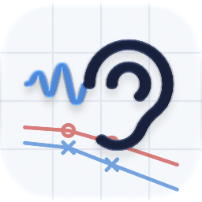
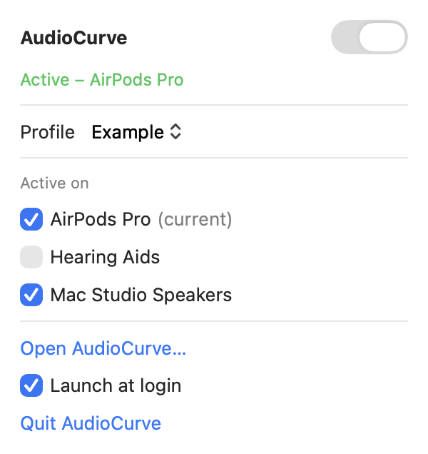

<p align="center">
  <picture>
    <source media="(prefers-color-scheme: dark)" srcset="docs/screenshots/icon-dark.png">
    
  </picture>
</p>

# AudioCurve

Hearing compensation for everything your Mac plays. AudioCurve shapes sound to your own audiogram, much like the headphone accommodations on iPhone with AirPods, but for any app and any output device. It runs from the menu bar and needs no other software; the same processing is also available as an Audio Unit (AUv3) effect for other audio apps.

**[⬇ Download the latest release](https://github.com/paddan/audiocurve/releases/latest)** · macOS 27 · Apple silicon


> **Not a medical device.** AudioCurve is a personal hobby project. It is not a hearing aid, it is not clinically validated, and it does not replace advice from an audiologist. Keep the volume at a comfortable level.

## Download

Requires macOS 27 on Apple silicon. Older versions are on the [Releases page](https://github.com/paddan/audiocurve/releases).

1. Download `AudioCurve-<version>-macos-arm64.zip` and unzip it.
2. Move `AudioCurve.app` to `/Applications`.
3. If the release notes say the build is ad hoc signed (not notarized), clear the download quarantine once:
   ```bash
   xattr -dr com.apple.quarantine /Applications/AudioCurve.app
   ```
4. Open `AudioCurve.app`. It appears as an ear in the menu bar. The first time it processes sound, macOS asks for permission to record system audio: allow it, or AudioCurve cannot hear what your Mac plays.

Releases are built by the [Release workflow](.github/workflows/release.yml) whenever a `v*` tag is pushed.

## Features

- **Audiogram editor.** Enter your hearing thresholds (dB HL, 125 Hz – 8 kHz) for each ear by dragging or typing. You can save several named versions, and the latest one is restored automatically.
- **Per-ear prescription.** A 12-band filterbank with wide dynamic range compression (WDRC) per band. Soft sounds get more gain than loud ones, and **Strength** scales the whole prescription. You can fine-tune each band with a per-band trim.
- **Two prescriptions.** Each ear gets a **speech** fitting (NAL-inspired, not NAL-NL2: more gain for soft sounds and a gentle high-frequency emphasis) and a **music** fitting (near-linear and warmer, with the low frequencies left alone). The compressors use two time constants, so the treble gain no longer follows every syllable.
- **Speech, Music or Auto.** Speech and Music use their own prescription and compressor time constants. In **Auto**, a lightweight classifier detects speech or music and glides between the two prescriptions and settings. The gain view shows both prescriptions.
- **Tone.** A **Clear ↔ Warm** control. Toward Warm it lowers the loud-sound gain in the treble for a fuller, softer sound, and leaves soft treble sounds audible.
- **Hearing safety.** A maximum output level (**Ceiling**, MPO) is enforced by a cross-band output budget with soft knees and a gentle true-peak limiter: a 5 ms smooth attack, with peaks detected on a 4× oversampled signal so inter-sample peaks stay under the ceiling. A hard clamp stays as the final guarantee. A **Safety** meter shows how hard the protection is working, and turning the limiter off asks for confirmation first.
- **Levels.** **Input level** sets how hard the compressors are driven, and **Output level** sets how close the output sits to the ceiling. **Auto level** picks an output level that keeps the limiter idle.
- **Live spectrum.** Input and output spectra per ear, with the ceiling marked.
- **Lab switches.** Compression and limiter can be turned off for listening experiments.
- **Realtime-safe DSP.** The Rust kernel never allocates or locks on the audio thread. It adds 400 frames of latency (about 8.3 ms at 48 kHz), which it reports to the host.
- **Measurement tool.** `cargo run --release --example measure` in `dsp/` runs the kernel offline on made-up example audiograms. It writes distortion, gain-modulation, safety-stage, true-peak and tone-balance numbers to `dsp/measurements/report.md` (with a comparison against the 2.0.0 baseline), and with `-- --wav` also A/B WAV files. `cargo test --release --test measurements` fails if a metric gets worse.

| Gain per band | Spectrum |
|---|---|
|  |  |

*The screenshots use a made-up, mildly sloping example audiogram and made-up device names. The panel picture is drawn by the app itself: `open AudioCurve.app --env AUDIOCURVE_DEMO=panel --env AUDIOCURVE_DEMO_OUT=<folder>`.*

## Using it

`AudioCurve.app` is a menu bar app. It captures what your Mac plays (a Core Audio process tap), runs it through AudioCurve and plays it on the current output device.

<p align="center">
  <picture>
    <source media="(prefers-color-scheme: dark)" srcset="docs/screenshots/panel-dark.png">
    
  </picture>
</p>

- **Menu bar panel:** click the ear. It has an on/off switch, a status line, the profile picker, **Active on** (one checkbox per output device), **Open AudioCurve…**, **Launch at login** and **Quit**. The ear is filled while AudioCurve processes sound, an outline while it is paused, and crossed out when it is off or something is wrong.
- **Active on:** AudioCurve only processes sound on the ticked outputs. For example, tick your headphones but not your hearing aids. On other outputs the sound plays as if AudioCurve were not running.
- **Window:** **Open AudioCurve…** shows the audiogram editor, the gain and spectrum views, the controls and the meters, with **Bypass (A/B)** at the top for comparing with and without AudioCurve.
- **Other audio apps:** the Audio Unit still works in hosts such as SoundSource, Audio Hijack or a DAW, with the same profiles. Do not run it there and in the menu bar app at the same time: the panel warns if the sound is processed twice.

A typical setup:

1. Enter your audiogram, or start from a flat profile, and save it.
2. Play something loud and press **Auto level**, or lower **Output level** until **Safety** stays near 0 dB.
3. Set the listening level with the Mac's own volume.

AudioCurve adds a little delay, about 8 ms in the DSP kernel, plus the audio device's buffering, which is not noticeable in video. If something goes wrong (permission denied, the plugin crashes, an output disappears), AudioCurve steps aside and the sound plays unprocessed.

**SoundSource says "Audio Unit Error" after an update?** SoundSource's background service still holds the old version of the plugin. Quit SoundSource, run `killall arkaudiod` in Terminal, and open SoundSource again.

## Building

Requirements:

- macOS 27 and Xcode with the Swift 6 toolchain.
- Rust via [rustup](https://rustup.rs), with the `aarch64-apple-darwin` target.
- [XcodeGen](https://github.com/yonaskolb/XcodeGen), if you change `project.yml`.

To build a release without Xcode, see [Building without Xcode](#building-without-xcode).

```bash
xcodegen generate                      # regenerate audiocurve.xcodeproj from project.yml
xcodebuild -scheme audiocurve -configuration Debug build
```

The Xcode build compiles the Rust DSP (`dsp/`) as a static library in a pre-build step.

Tests:

```bash
cd dsp && cargo test                   # DSP: filterbank, compressor, limiter, classifier, FFI layout
cd Packages/AudioCurveCore && swift test   # fitting rule, profile storage, auto-level
```

Run `docs/manual-test.md` for the checks that need ears and a real host.

### Building without Xcode

A release build needs only the Command Line Tools and Rust:

```bash
xcode-select --install                 # Command Line Tools (swiftc, clang, codesign, lipo)
curl https://sh.rustup.rs -sSf | sh    # Rust via rustup; the needed targets are added on demand
```

```bash
make release                           # build/release/AudioCurve.app with the embedded AudioCurveAU.appex
make install                           # copy to /Applications and register the extension
```

The `Makefile` compiles the Rust DSP as a static library, compiles the Swift sources with `swiftc` (Swift 6 language mode, macOS 27 deployment target, the same settings as `project.yml`), turns the String Catalogs into `.lproj/Localizable.strings` files with `scripts/xcstrings2strings.py` (the Xcode-only `xcstringstool` is not needed), and assembles and signs the bundles. The extension is signed with `AU/AudioCurveAU.entitlements`, because an AUv3 extension must run in the App Sandbox.

Other targets and options:

| Command | What it does |
|---|---|
| `make release ARCHS="arm64 x86_64"` | Universal build for Apple silicon and Intel |
| `make release SIGN_IDENTITY="Developer ID Application: …"` | Sign with a Developer ID (hardened runtime, secure timestamp) instead of ad hoc |
| `make notarize SIGN_IDENTITY="…" NOTARY_PROFILE=<profile>` | Notarize and staple; create the profile once with `xcrun notarytool store-credentials` |
| `make uninstall` | Unregister the extension and remove the app from `/Applications` |
| `make test` | Run the Rust and Swift package tests |
| `make clean` | Remove `build/` |

An ad hoc signed build runs on the Mac that built it. To give it to other people, sign it with a Developer ID and notarize it.

After `make install`, `pluginkit -m -v | grep audiocurve` should list the extension in `/Applications`. If an Xcode build in DerivedData is also registered, macOS can pick either copy. Remove the one you do not want with `pluginkit -r <path to AudioCurveAU.appex>`.

The macOS 27 SDK declares SwiftUI's `@State` as a macro, and its compiler plugin ships only with Xcode. Views therefore use `@ViewState`, an alias of the `State` property wrapper (`App/ViewState.swift`, `AU/UI/ViewState.swift`). `make release` stops with an error if `@State` shows up again.

## Layout

| Path | What it is |
|---|---|
| `dsp/` | Rust DSP kernel behind a small C ABI: filterbank, WDRC, output budget, limiter, meters, spectrum, speech/music classifier |
| `Packages/AudioCurveCore/` | Swift package: C header, fitting rule (audiogram → band gains), profile storage, auto-level, route state machine, app ↔ plugin channel |
| `AU/` | The AUv3 extension: parameters, state and the SwiftUI interface |
| `App/` | The menu bar app: system audio capture (`App/Audio/`), plugin host, panel and window |
| `docs/` | Design spec and manual test checklist |
| `App/AppIcon.icon` | App icon (Icon Composer, light and dark); `assets/AppIcon.icns` is a dark fallback for builds without Xcode |
| `Makefile`, `scripts/` | Release build without Xcode |

## License

[MIT](LICENSE) © 2026 Patrik Lindefors
