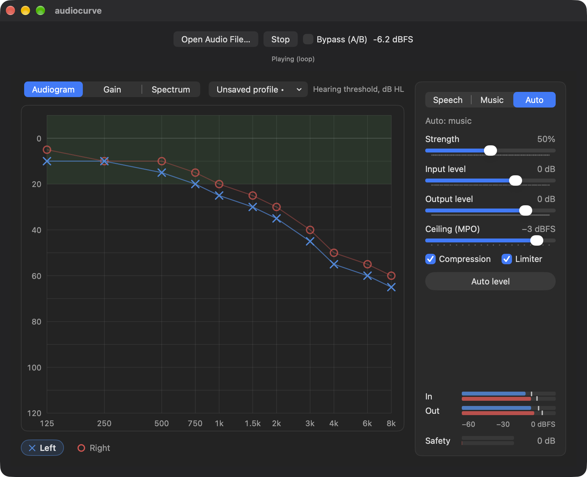
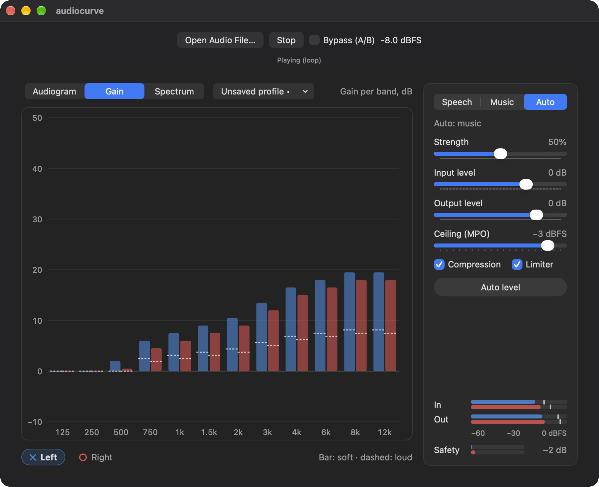
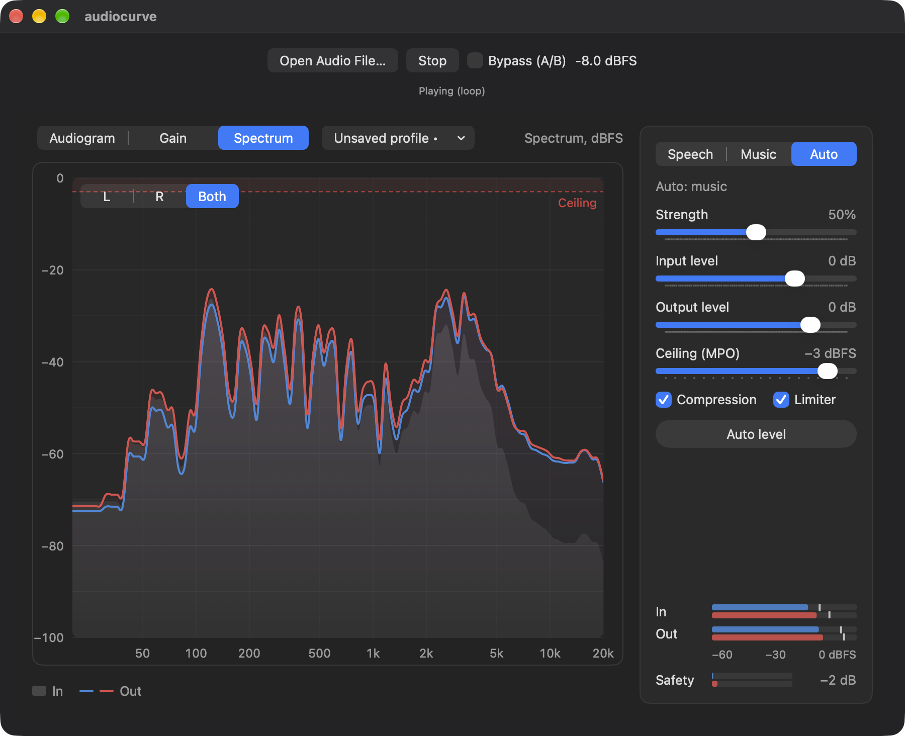

# audiocurve

Hearing compensation for everything your Mac plays. audiocurve is an Audio Unit (AUv3) effect that shapes sound to your own audiogram, much like the headphone accommodations on iPhone with AirPods, but for any app and any output device.



> **Not a medical device.** audiocurve is a personal hobby project. It is not a hearing aid, it is not clinically validated, and it does not replace advice from an audiologist. Keep the volume at a comfortable level.

## Features

- **Audiogram editor.** Enter your hearing thresholds (dB HL, 125 Hz – 8 kHz) for each ear by dragging or typing. You can save several named versions, and the latest one is restored automatically.
- **Per-ear prescription.** A 12-band filterbank with wide dynamic range compression (WDRC) per band. Soft sounds get more gain than loud ones, and **Strength** scales the whole prescription. You can fine-tune each band with a per-band trim.
- **Speech, Music or Auto.** These modes set the compressor time constants. In **Auto**, a lightweight classifier detects speech or music and glides between the two settings.
- **Hearing safety.** A maximum output level (**Ceiling**, MPO) is enforced by a cross-band output budget with soft knees and a lookahead peak limiter. A **Safety** meter shows how hard the protection is working, and turning the limiter off asks for confirmation first.
- **Levels.** **Input level** sets how hard the compressors are driven, and **Output level** sets how close the output sits to the ceiling. **Auto level** picks an output level that keeps the limiter idle.
- **Live spectrum.** Input and output spectra per ear, with the ceiling marked.
- **Lab switches.** Compression and limiter can be turned off for listening experiments.
- **Realtime-safe DSP.** The Rust kernel never allocates or locks on the audio thread. It adds 5 ms of latency, which it reports to the host.

| Gain per band | Spectrum |
|---|---|
|  |  |

*The screenshots use a made-up, mildly sloping example audiogram.*

## Using it

audiocurve is an AUv3 *effect* extension, so it runs inside an audio host:

- **System-wide:** load it in an app that can insert Audio Units on system output, such as SoundSource or Audio Hijack.
- **Bundled test host:** `audiocurve.app` opens an audio file, loops it through the plugin and has an A/B bypass. Running the app once also registers the extension with macOS.

A typical setup:

1. Enter your audiogram, or start from a flat profile, and save it.
2. Play something loud and press **Auto level**, or lower **Output level** until **Safety** stays near 0 dB.
3. Set the listening level with the Mac's own volume.

## Building

Requirements:

- macOS 27 and Xcode with the Swift 6 toolchain.
- Rust via [rustup](https://rustup.rs), with the `aarch64-apple-darwin` target.
- [XcodeGen](https://github.com/yonaskolb/XcodeGen), if you change `project.yml`.

```bash
xcodegen generate                      # regenerate audiocurve.xcodeproj from project.yml
xcodebuild -scheme audiocurve -configuration Debug build
```

The Xcode build compiles the Rust DSP (`dsp/`) as a static library in a pre-build step.

Tests:

```bash
cd dsp && cargo test                   # DSP: filterbank, compressor, limiter, classifier, FFI layout
cd Packages/AudioCurveCore && swift test   # fitting rule, profile storage, auto-level
```

Run `docs/manual-test.md` for the checks that need ears and a real host.

## Layout

| Path | What it is |
|---|---|
| `dsp/` | Rust DSP kernel behind a small C ABI: filterbank, WDRC, output budget, limiter, meters, spectrum, speech/music classifier |
| `Packages/AudioCurveCore/` | Swift package: C header, fitting rule (audiogram → band gains), profile storage, auto-level |
| `AU/` | The AUv3 extension: parameters, state and the SwiftUI interface |
| `App/` | Container and test-host app |
| `docs/` | Design spec and manual test checklist |

## License

[MIT](LICENSE) © 2026 Patrik Lindefors
